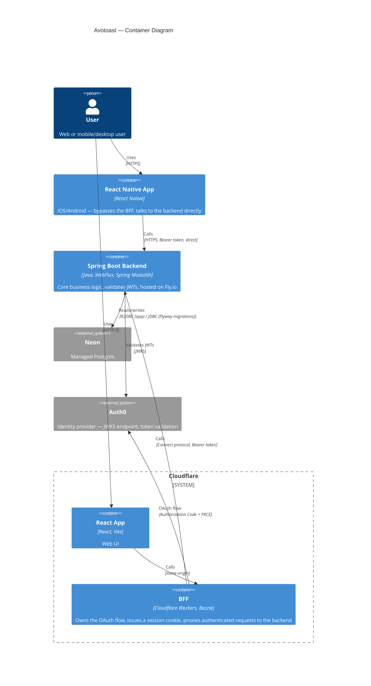

<p align="center">
  <picture>
    <source media="(prefers-color-scheme: dark)" srcset="brand/wordmark-dark.png">
    
  </picture>
</p>

<p align="center"><b>Full-stack, toasted my way.</b><br>
My opinionated starter: React on Cloudflare, Spring Boot on Fly.io, auth by Bezzie.</p>

<p align="center"><a href="LICENSE"></a></p>

<p align="center">
  <a href="https://github.com/neilpmas/avotoast">avotoast</a> ·
  <a href="https://github.com/neilpmas/avotoast-frontend">frontend</a> ·
  <a href="https://github.com/neilpmas/avotoast-backend">backend</a> ·
  <a href="https://github.com/neilpmas/bezzie">bezzie (auth)</a>
</p>

Avotoast is the stack I start every new app from. The template is the toast: a plain, reliable base with auth, a database, CI and the wiring already done. Your app is the avocado you put on top. It is opinionated and built for me first. If it suits you too, take it.

## What's on the toast

- **Web:** React 19, Vite, Tailwind and shadcn/ui, served from Cloudflare Workers as static assets.
- **BFF:** a Cloudflare Worker running [Bezzie](https://github.com/neilpmas/bezzie), so the browser gets a session cookie and JWTs never touch it.
- **Backend:** Spring Boot 4 with Spring Modulith, on Fly.io, talking to the BFF over the Connect protocol.
- **Data:** Neon Postgres via R2DBC, with Flyway migrations.
- **Identity:** Auth0, one tenant shared across apps.
- **Monorepo:** Turborepo. A React Native app is planned but not in the template yet.

## Quick start

```bash
gh repo create my-org/myapp-frontend --template neilpmas/avotoast-frontend --public
gh repo create my-org/myapp-backend  --template neilpmas/avotoast-backend  --public
```

Then follow [Local Development](#local-development) to run it, and [Starting a New App](#starting-a-new-app) to provision Neon, Auth0, Fly.io and Cloudflare.

## Why these choices

- **BFF for the browser:** tokens stay on the server, so there is nothing to steal from `localStorage`.
- **Near free at rest:** about $2 a month per app, so I can run many experiments and only pay for the ones that work (see [Cost Philosophy](#cost-philosophy)).
- **Modulith from day one:** module boundaries are enforced before the codebase grows.
- **Connect, not gRPC-Web:** it works from a Worker using plain `fetch()` (see [Protocol Decisions](#protocol-decisions)).
- **Same stack every time:** consistency is what makes reuse cheap.

## How it's built

Each app is specced before any code is written, in a private planning repo. I work with Claude to turn those specs into code, and I review and commit every change myself. The workflow is as much an experiment as the template is.

---

## Repos

| Repo | Purpose |
|---|---|
| [avotoast](https://github.com/neilpmas/avotoast) | This repo — architecture, decisions, workflow guide |
| [avotoast-frontend](https://github.com/neilpmas/avotoast-frontend) | React + Cloudflare Workers BFF |
| [avotoast-backend](https://github.com/neilpmas/avotoast-backend) | Spring Boot backend |
| [bezzie](https://github.com/neilpmas/bezzie) | BFF OAuth 2.0 auth library for Cloudflare Workers, used by the frontend's BFF |

---

## Architecture Overview



### Client model

The BFF exists solely to protect browser-based clients — browsers cannot store tokens safely. Mobile and desktop clients have secure OS credential stores and talk directly to Spring Boot.

| Client | Auth pattern | Talks to |
|---|---|---|
| React (web) | Session cookie via BFF — JWTs never touch the browser | BFF → Spring Boot |
| React Native (mobile) | Bearer token direct from Auth0 | Spring Boot directly |
| Desktop | Bearer token direct from Auth0 | Spring Boot directly |

Spring Boot validates JWTs from all clients identically — it doesn't distinguish between BFF-forwarded and direct requests.

---

## Stack

### Frontend & BFF — Turborepo monorepo

| Technology | Version | Purpose |
|---|---|---|
| React | 19 | Web UI |
| Vite | 8 | Build tool |
| Tailwind CSS | 4 | Styling |
| shadcn/ui | — | Component library (Radix UI, copy-paste, you own the code) |
| Turborepo | — | Monorepo — web, mobile, BFF as packages |
| Cloudflare Workers | — | BFF, auth proxy, Connect protocol → backend |
| [Bezzie](https://github.com/neilpmas/bezzie) | — | BFF OAuth 2.0 library (open source) |
| Cloudflare KV | — | Session storage |
| React Native | — | iOS and Android (Auth0 RN SDK, `expo-secure-store`). Planned, not yet in the template |

```
<app>/
  apps/
    web/        ← React (Workers static assets)
    mobile/     ← React Native (iOS + Android), planned
    bff/        ← Cloudflare Workers + Bezzie
  packages/
    proto/      ← Protobuf definitions + generated TypeScript Connect client
    types/      ← shared TypeScript types
    api-client/ ← shared API client
```

### Backend

| Technology | Version | Purpose |
|---|---|---|
| Spring Boot | 4.1.1 | Core business logic |
| Spring Modulith | 2.1.0 | Enforces module boundaries |
| Java | 27 | Language |
| Maven | — | Build (wrapper included) |
| Spring Data R2DBC | — | Reactive database access |
| Flyway | 13.3.0 | Schema migrations |
| [connectrpc-spring-boot-starter](https://github.com/neilpmas/connectrpc-spring-boot) | 0.2.1 | Connect protocol endpoint (Maven Central) |

### Database

**[Neon](https://neon.tech)** — managed serverless Postgres. One Neon project per app.

> **Critical:** Always use the **direct connection string** (port 5432), not the Neon pooler URL (port 6543). The transaction-mode pooler breaks R2DBC prepared statements.

Two connection strings are needed — one for R2DBC (the app) and one for JDBC (Flyway migrations only):

| Variable | Format | Used by |
|---|---|---|
| `R2DBC_URL` | `r2dbc:postgresql://ep-xxx.us-east-2.aws.neon.tech:5432/template` | Spring Data R2DBC |
| `DATABASE_URL` | `jdbc:postgresql://ep-xxx.us-east-2.aws.neon.tech:5432/template` | Flyway |

**Cost at rest:** Free tier. Neon autosuspends compute after ~5 minutes of inactivity; cold start is ~500ms. Pick the Neon region closest to your Fly.io machine.

**Why Neon, and what lost:**

| Option | Verdict |
|---|---|
| **Neon** | **Chosen.** Real Postgres, so R2DBC and Flyway work as normal. It scales to zero between requests, and the free tier covers many small projects, which suits one database per app and the [cost philosophy](#cost-philosophy). |
| Supabase | Also managed Postgres, and a real contender. Neon won on scale-to-zero behaviour, which is what keeps cost at rest low across several apps. |
| Fly.io Postgres | Unmanaged: backups, upgrades and failover would be on you. |
| SQLite (with Litestream) | R2DBC support is community-only and weak. The most complete driver, `r2dbc-sqlite`, does blocking file access, so it can't be genuinely non-blocking, and SQLite's single-writer file lock is a poor fit for a reactive stack. |
| Cloudflare D1 / Durable Objects SQLite | Reachable only from inside Workers through bindings, not from the Fly.io backend over R2DBC or JDBC. Reaching D1 from outside means its HTTP API, which drops R2DBC, Flyway and plain SQL. It would only make sense if the BFF owned the data, which is a different architecture. |

Decided in the original architecture review. SQLite and D1 were re-checked on 2026-10-20 and the decision stands. Revisit it if an R2DBC SQLite driver reaches the official driver registry, or if the BFF ever takes ownership of the data.

### Authentication

**[Auth0](https://auth0.com)** — identity and access management.

One Auth0 tenant shared across all apps on the stack. Same user identity, SSO possible, users don't re-register per app.

Per app, register:
- One **Regular Web Application** (for the BFF — has a client secret)
- One **API** (represents the Spring Boot backend, defines the audience)

RBAC roles and permissions are scoped per API — no bleed between apps.

---

## Protocol Decisions

### Browser → Cloudflare edge
HTTP/3 — handled automatically by Cloudflare. No configuration needed.

### BFF → Spring Boot
**Connect protocol** — Cloudflare Workers calls Spring Boot via [Connect protocol](https://connectrpc.com) (binary format, `POST /connect/{service}/{method}`) using `fetch()`.

**Why not native gRPC:** workerd (the Cloudflare Workers runtime) has no `http2.connect` — Workers cannot originate an HTTP/2 connection with trailers, which gRPC requires.

**Why not gRPC-Web:** gRPC-Web is a *different wire format* from native gRPC (length-prefixed frames with a trailer-in-body encoding), not just gRPC-over-HTTP/1.1. It looked like the answer here but was never actually compatible with this backend's plain gRPC service (`net.devh:grpc-spring-boot-starter`) — the two speak incompatible wire formats, and there's no gRPC-Web server implementation for Spring Boot to bridge the gap.

**The fix:** [`connectrpc-spring-boot-starter`](https://github.com/neilpmas/connectrpc-spring-boot) — a real, published library (Maven Central, `dev.neilmason:connectrpc-spring-boot-starter`) built specifically to fill this gap, since Connect protocol had no official Java/Spring implementation. It auto-configures a `/connect/{service}/{method}` endpoint directly from existing gRPC service definitions via reflection, so existing gRPC service implementations are reused as-is — no hand-rolled endpoint code in any app repo.

**Cloudflare Workers `fetch()` caveat:** `@connectrpc/connect-web` hardcodes `redirect: "error"` on its `fetch()` calls, which is valid in browsers but throws `TypeError: Invalid redirect value` under workerd (only `"follow"`/`"manual"` are supported there). The BFF wraps `fetch` (`workersFetch.ts`) to strip that option before delegating to the real `fetch()`.

### Mobile/Desktop → Spring Boot
Standard HTTPS with Bearer token. REST by default.

### Spring Boot → Neon
**R2DBC** over TCP — reactive, non-blocking. The app uses Spring Data R2DBC for all database access.

**Flyway** uses a separate JDBC connection for migrations only — JDBC is synchronous and Flyway requires it.

Both must use the **direct** Neon endpoint (port 5432), not the pooler.

---

## Authentication Detail

### Web: BFF-based OAuth (BCP212)

The BFF pattern keeps JWTs out of the browser entirely.

**Auth0 setup:**

| Setting | Description |
|---|---|
| `AUTH0_DOMAIN` | e.g. `your-tenant.auth0.com` |
| `AUTH0_CLIENT_ID` | Web application client ID |
| `AUTH0_CLIENT_SECRET` | Web application client secret — held only by the BFF Worker |
| `AUTH0_AUDIENCE` | API identifier — must match `AUTH0_AUDIENCE` in the backend |

The audience value must be identical in the BFF and Spring Boot. If they don't match, JWT validation fails.

**Login flow:**
```
React → BFF /auth/login → Auth0 (Authorization Code + PKCE)
                                  │
                             code returned
                                  │
             BFF exchanges code for tokens → stored in Cloudflare KV
             BFF issues HttpOnly; Secure; SameSite=Lax session cookie → React
```

**Per-request flow:**
```
React (session cookie) → BFF → validates session, refreshes token if expired
                              → Spring Boot (Connect protocol + Authorization: Bearer <token>)
```

### Mobile: RFC 8252 (OAuth for Native Apps)

```
React Native → Auth0 SDK (Authorization Code + PKCE)
                       │
                  tokens stored in iOS Keychain / Android Keystore (expo-secure-store)
                       │
React Native (Authorization: Bearer <token>) → Spring Boot (direct)
```

### Backend: Resource server

Spring Boot validates JWTs on every protected request using Auth0's JWKS endpoint. Works identically for BFF-forwarded and direct mobile requests.

```yaml
spring:
  security:
    oauth2:
      resourceserver:
        jwt:
          issuer-uri: ${AUTH0_ISSUER_URI}   # https://your-tenant.auth0.com/
          audiences: ${AUTH0_AUDIENCE}       # https://api.yourproject.com
```

Roles and permissions are defined in Auth0, included in the JWT as a `permissions` claim. Enable **RBAC** and **Add Permissions in the Access Token** in the Auth0 API settings.

```java
@PreAuthorize("hasAuthority('read:data')")
```

---

## Local Development

### Prerequisites

| Tool | Version | Install |
|---|---|---|
| Java | 27 | [Temurin 27](https://adoptium.net) or [SDKMAN](https://sdkman.io) |
| Node.js | 20+ | [nodejs.org](https://nodejs.org) or `brew install node` |
| npm | 11 | included with Node |
| Docker | any | [Docker Desktop](https://www.docker.com/products/docker-desktop) |
| Wrangler | latest | `npm install -g wrangler` |
| Buf CLI | latest | `brew install bufbuild/buf/buf` (only if regenerating proto) |

### Stack when running locally

```
React (Vite dev server — port 5173)
    ↓
Cloudflare Workers (wrangler dev — port 8787)
    ↓
Spring Boot (port 8080 HTTP, port 9090 gRPC)
    ↓
Postgres (Docker — port 5432)
```

### Getting started (all three repos)

1. **Start Postgres** (database `template`, user `postgres`, password `password`; local development only):
   ```bash
   cd avotoast-backend
   docker compose up -d
   ```

2. **Backend** — copy `src/main/resources/application-local.yml.example` → `application-local.yml` (gitignored; the database credentials already match the compose file, just fill in the Auth0 values), then:
   ```bash
   cd avotoast-backend
   ./mvnw spring-boot:run
   ```

3. **Frontend + BFF** — copy `apps/bff/.dev.vars.example` → `apps/bff/.dev.vars` (gitignored; it lists every variable the BFF needs), then:
   ```bash
   cd avotoast-frontend
   npm install
   npm run dev
   ```

4. **Open** `http://localhost:5173`

Auth0: use a real Auth0 dev tenant (free tier). Register a separate application for local dev so local and production credentials are isolated.

The browser talks only to Vite on port 5173, which proxies `/auth/*` and `/api/*` to the BFF on port 8787. Keep `APP_BASE_URL` at `http://localhost:5173` so the session cookie and the Auth0 callback land on the same origin. Plain `http://localhost` works for local dev; no HTTPS or mkcert setup is needed.

---

## Starting a New App

Do these steps before writing any feature code. The template handles all the infrastructure.

### 1. Clone the template repos

```bash
gh repo create my-org/myapp-frontend --template neilpmas/avotoast-frontend --public
gh repo create my-org/myapp-backend  --template neilpmas/avotoast-backend  --public
```

### 2. Provision infrastructure

In order:
1. **Neon** — create a new project, copy the direct connection strings (port 5432)
2. **Auth0** — create a Regular Web Application (for BFF) and an API (for backend)
3. **Fly.io** — `fly launch` in the backend repo
4. **Cloudflare** — `wrangler deploy` in the BFF app

**Setup checklist (each of these has cost someone an afternoon):**

- **GitHub:** enable auto-merge on each repo after creating it (`gh api repos/<owner>/<repo> --method PATCH -f allow_auto_merge=true`). The Dependabot auto-merge workflow fails silently without it.
- **Neon:** pick the region closest to your Fly.io region (the default, US East, is wrong for a Sydney deploy; use `ap-southeast-2`). Create a `dev` branch straight after creating the project, before any migrations run, so it starts as a clean copy of `main`. Copy the **direct** connection strings (port 5432); the pooler breaks Flyway migrations.
- **Auth0, API:** creating the API and the Regular Web Application is not enough. Under *Applications → APIs → your API → Application Access → User Delegated*, grant the web application access, or the authorize endpoint returns `Client is not authorized to access resource server`. Also enable **Allow Offline Access** on the API, otherwise Bezzie gets no refresh token and logs a warning.
- **Auth0, application URLs:** *Allowed Callback URLs*, *Allowed Logout URLs* and *Allowed Web Origins* must exactly match `APP_BASE_URL` (the public origin, with `/auth/callback` on the callback), not the BFF's internal port. Auth0 does exact string matching.
- **Cloudflare zone rate-limit rule:** the BFF's own limiters can't stop an unauthenticated flood from waking the Worker and spending KV writes. Add a rate-limit rule on your zone for URI paths starting with `/auth/` or `/api/` (the free plan allows one rule: 20 requests per 10s per IP, action Block worked for the todo app). It stops requests before the Worker runs. Needs your own domain on Cloudflare.
- **Sentry (optional, free tier):** create one project per runtime and set `SENTRY_DSN` on each: `fly secrets set SENTRY_DSN=...` for the backend, a Workers variable for the BFF. Unset is a documented no-op, so the apps run fine without it. Errors only, no tracing and no default PII.
- **Auth0, variables:** the BFF needs `AUTH0_DOMAIN`, `AUTH0_CLIENT_ID`, `AUTH0_CLIENT_SECRET`, `AUTH0_AUDIENCE`, `APP_BASE_URL` and `BACKEND_URL`. Empty strings in `wrangler.toml` pass validation but fail at runtime, so check all six are set.

> **After first deploy, verify the Neon branch:** Neon branches can share the same database and role name, so a "Connect" string copied from the dashboard can look identical regardless of which branch it's actually for — only the compute endpoint ID differs. Read the deployed app's actual `DATABASE_URL`/`R2DBC_URL` (off the running instance, not the dashboard) and confirm the endpoint ID matches whichever branch is meant to be production. Found the hard way on the todo app: it had been running against `dev` for months while `production` sat empty and unused, undiscovered until an unrelated backup workflow started producing suspiciously small dumps.

> **Workers Builds runs from the repo root, so declare what it calls there.** Workers Builds runs `npm clean-install` and then `npx wrangler deploy --config apps/<app>/wrangler.toml` from the root. `wrangler` and `vitest` are root devDependencies in the frontend template for this reason: if `wrangler` is declared only in `apps/bff`, a dependency change can move it under `apps/bff/node_modules` and the deploy step fails with `sh: 1: wrangler: not found`. The CI `build` check doesn't exercise the deploy step, and the live site keeps serving the previous build, so nothing looks broken. Before merging a dependency change, reproduce it from a clean tree (`npm clean-install`, then `npx wrangler deploy --dry-run --config apps/bff/wrangler.toml` from the root), or watch the `Workers Builds: ...` checks on the merge commit rather than only `build`.

> **Cloudflare Workers Builds naming:** if the native Git integration is connected, its auto-generated project name must match the `name` field in `wrangler.toml` *before* the first deploy that includes a route — a mismatch fails with `Can't deploy routes that are assigned to another worker.` Cloudflare's own resolution is to update `wrangler.toml` to match the Workers Builds project name (not rename the project), so set these to match from the start rather than debugging it on the first route-based deploy.

### 3. Recommended CI/CD additions (add once your app is real, not part of the template's own CI)

Neither of these ships active in the template repos — the template itself never goes live, so wiring a real deploy or backup workflow into its own CI would just fail on every merge/schedule forever, against infrastructure that doesn't and shouldn't exist for it. Copy them into your new app's own repo once the corresponding real infrastructure from step 2 exists:

- **Deploy-on-merge to Fly.io** — copy `todo-app-backend`'s `.github/workflows/deploy.yml` verbatim once you have a real Fly app. Closes the "CI passed but nobody actually shipped it" gap — triggers on the CI workflow's own success on `main`, deploys the exact commit CI validated. Needs a deploy-scoped `FLY_API_TOKEN` (`fly tokens create deploy`) as a repo secret.
- **Nightly database backup to R2** — copy `todo-app-backend`'s `.github/workflows/backup.yml` once you have a real Neon database and an R2 bucket (Neon's free tier caps point-in-time restore at 6 hours). See that file directly for the hard-won gotchas (matching `pg_dump`'s version to Neon's server, a size/content floor so a dump against an empty database doesn't silently "succeed," never logging real row content since Actions logs are world-readable on a public repo). Needs `BACKUP_DATABASE_URL` (Neon's direct connection string) plus `R2_ACCESS_KEY_ID`/`R2_SECRET_ACCESS_KEY`/`R2_ACCOUNT_ID`/`R2_BUCKET` as repo secrets.

### 3a. Optional: nudge stale Dependabot PRs

Unlike the two above, this one ships in the template repos (`.github/workflows/nudge-stale-dependabot-prs.yml` in both frontend and backend), but it is inert until you opt in. A weekly job comments `@dependabot recreate` on any Dependabot PR open over 7 days, so a PR that is red because it's blocked on an upstream fix gets regenerated against current `main` and the current registry, and can auto-merge once the blocker clears, with nobody needing to remember to check back.

To enable it in your new app's repos:
1. Create a fine-grained PAT, scoped to just that repo, with **Pull requests: read/write** only.
2. Add it as a repo secret named `DEPENDABOT_PAT` (needed per repo — secrets aren't inherited from the template). Dependabot rejects `@dependabot recreate` from the default `github-actions[bot]` actor ("only users with push access can use that command"), so `GITHUB_TOKEN` can't be used here.

Without the secret the job skips cleanly and does nothing.

> **Leave blocked Dependabot PRs open.** `@dependabot recreate` can't revive a closed PR, and closing one tells Dependabot to stop proposing that version. If a PR is red because of an upstream blocker, leave it open and let the weekly nudge retry it.

### 3b. Turn on dependency alerts (once the app is real)

Not on in the template repos, because nothing runs from them. In your new app's repos, under **Settings → Advanced Security**, turn on **Dependabot alerts** and **Dependabot security updates**. In the **backend** repo, also turn on **Automatic dependency submission**.

The backend step matters: for Maven, GitHub's dependency graph only reads versions declared in `pom.xml`. Everything Spring Boot's BOM manages, and everything pulled in transitively (Jackson, Netty, scram and so on), is invisible to it, so alerts stay at zero while real advisories sit in the resolved tree. Automatic dependency submission resolves the full tree, and the alerts then appear. The frontend needs nothing extra, since the npm lockfile is read directly.

What to expect:
- **Alerts show up, but Dependabot can't fix transitive Maven dependencies.** Its security-update jobs are limited to direct dependencies, so for a Boot-managed library the run fails and no PR is opened. That failing run is normal, not a sign something is broken.
- **The fix is usually a Spring Boot parent bump,** which Dependabot does raise as a normal version-update PR. Merge it when it arrives.
- **Pin a version by hand only when** the advisory is high or critical, the service is deployed, and Boot hasn't shipped a fix within a week or two. Override the Boot property (for Jackson, `jackson-bom.version`) or add a `dependencyManagement` entry, and leave a comment saying to remove it once Boot catches up.
- **npm has the same limit.** Dependabot won't raise a security PR for a transitive npm package either (the job fails with `security_update_not_possible`). Fix it by hand: update the parent in the lockfile (`npm update <parent> --package-lock-only`) and raise its floor in `package.json` so it can't drift back. Example: `undici` arrives through `jsdom`, `shadcn` and `miniflare`, and bumping `jsdom` pulled in the patched `undici`.
- **Dependabot's default of 5 open PRs per ecosystem will quietly throttle you.** One PR stuck on an upstream blocker permanently holds a slot, so the effective limit shrinks and newer versions never get a PR, with no alert. Both template `dependabot.yml` files set `open-pull-requests-limit: 20` for this reason. Keep it if you edit the file. If a known-blocked major version is holding a slot, add an `ignore` entry for it.
- **CodeQL will flag two things on a fresh app.** `actions/missing-workflow-permissions` on any workflow without a top-level `permissions:` block: the template's `ci.yml` has one, so add `permissions: contents: read` (or tighter) to any workflow you copy in, such as `deploy.yml` and `backup.yml`. And `java/spring-disabled-csrf-protection` on the backend's `SecurityConfig`: a false positive for a stateless JWT resource server with no cookie auth, so dismiss it as a false positive (the comment in `SecurityConfig` explains why).
- **Treat IDE scanners (for example Mend) as hints, not a to-do list.** They report CVEs that GitHub and OSV don't, so check an alert against GitHub's own before acting.
- **Private repos:** alerts, security updates and dependency submission are free but use Actions minutes. Branch protection, and so Dependabot auto-merge, needs a paid GitHub plan (Pro is enough).

### 3c. Set the web app's Content Security Policy

`avotoast-frontend` ships a strict starter policy in `apps/web/public/_headers`. Vite copies it into `dist/`, and Cloudflare Workers Static Assets applies it natively, so there is no code to change. This is separate from the BFF's own CSP, which only covers what the BFF itself serves (its `/auth/*` routes and so on). The static-assets Worker needs its own policy for what it renders.

The starter is `default-src 'none'` with `'self'` for scripts, styles, fonts and `connect-src`, and `img-src 'self' data:`. Those values hold for any app built on this template: no inline scripts or styles, fonts self-hosted through `@fontsource-variable`, and same-origin `/api/*` and `/auth/*` calls only.

**One value is yours to set: `img-src`.** The dashboard renders `user.picture` from the login provider's profile, and the host depends on the provider. With the starter, the picture is blocked until you add it, and a blocked image fails silently, so do this before deploying:

| Login provider | Add to `img-src` |
|---|---|
| Google | `https://*.googleusercontent.com` |
| GitHub | `https://avatars.githubusercontent.com` |
| Email and password (Gravatar) | `https://*.gravatar.com` |

Allow only the provider your Auth0 tenant actually uses, not all of them defensively.

**Another value is yours to set: `form-action`.** The starter ships `form-action 'self' https://your-tenant.auth0.com`. Replace the placeholder with your real `AUTH0_DOMAIN`. Logout is a same-origin form POST that the BFF answers with a 302 to `https://<AUTH0_DOMAIN>/v2/logout`, and browsers enforce the submitting page's `form-action` against that redirect too. If the Auth0 origin isn't listed, the browser refuses to follow it: DevTools shows a 302, the page stays put, Auth0's SSO session is never ended, and nothing says why. `apps/web/src/headers.test.ts` reads `AUTH0_DOMAIN` from `apps/bff/wrangler.toml` and fails if `form-action` doesn't contain it, so set the domain in both places in the same change.

**Decide on Cloudflare Web Analytics.** If automatic setup is on for the zone, Cloudflare injects `https://static.cloudflareinsights.com/beacon.min.js` into the HTML at the edge, and `script-src 'self'` blocks it: visits are never counted and the console shows a CSP error. Either turn automatic setup off, or add `https://static.cloudflareinsights.com` to `script-src`. The beacon reports back through the site's own `/cdn-cgi/rum`, which `connect-src 'self'` already covers. Apps on the same zone share one beacon token, so their visits land in one Web Analytics property.

**Re-derive the other directives whenever the app changes**, rather than copying values across apps. Check the source and the built `dist/index.html` for inline `<script>`/`<style>` and for `style={{...}}`, check where fonts load from, and grep for `fetch(` and external URLs. Anything new that loads from another origin needs its own entry.

**Verify against the real build, not by reading directives.** Build the app, serve `dist/` with `npx wrangler dev --assets ./dist` (it honours `_headers` the same as production), confirm the header is on the response, and watch the browser console for CSP violations while you click through the signed-in pages. The signed-in dashboard is where an avatar or a dialog would trip the policy. Reference implementation: `todo-app-frontend/apps/web/public/_headers`.

### 3d. Optional: make Dependabot auto-merges trigger CI and deploys

Dependabot auto-merge merges with `GITHUB_TOKEN`, and GitHub does not start workflow runs for events created by `GITHUB_TOKEN`. So the merge commit lands on `main` and nothing runs for it: no CI `push` run, and no deploy that hangs off CI. Found on the todo app, where nine Dependabot bumps merged and production sat on the older build with all of them undeployed. Nothing failed visibly.

This matters once an app has a workflow that reacts to pushes on `main`. The template's own CI is unaffected, so this ships inert, like the nudge in 3a. Both repos' `dependabot-auto-merge.yml` use `${{ secrets.DEPENDABOT_PAT || secrets.GITHUB_TOKEN }}`: with no secret they behave as before, and with one the merge counts as a real user's push.

To enable it in your new app's repos:
1. Create a fine-grained PAT scoped to just that repo with **Pull requests: read/write** and **Contents: read/write**. The same token can serve the nudge in 3a.
2. Store it as `DEPENDABOT_PAT` in the **Dependabot** secret store (`gh secret set DEPENDABOT_PAT --app dependabot --repo <repo>`), not only in Actions secrets. The auto-merge job runs as `dependabot[bot]`, and GitHub gives those runs Dependabot secrets only. The nudge in 3a runs on a schedule, so it needs the Actions copy. If you use both, set both.
3. If you copy in a deploy workflow, give it `concurrency: {group: <name>, cancel-in-progress: false}`, because a batch of Dependabot merges now starts several deploys at once. Add `workflow_dispatch:` to the workflow it hangs off if you want to re-trigger it by hand (the template's `ci.yml` already has it).

**The cost:** the PAT is per project and expires (the todo app used 90 days), so the template can't ship one. Put the renewal in a calendar. When it lapses, auto-merges start failing and Dependabot PRs sit open.

### 4. Define the domain

Before writing feature code:
- What does this product do? Who are the users? What is the core use case?
- Key entities and relationships, data model (tables, fields)
- gRPC service definitions (`.proto` files) — agree on API contract before frontend or backend work starts

---

## Testing Strategy

| Layer | Approach |
|---|---|
| Spring Boot — unit | JUnit 5, plain unit tests for domain logic (TDD) |
| Spring Boot — integration | Testcontainers — real Postgres, no mocks |
| BFF (Workers) | Vitest + `@cloudflare/vitest-plugin` |
| React | Vitest + React Testing Library |
| E2E | Playwright |

Notes:
- Docker must be running locally for Testcontainers
- Spring Boot 4+ has built-in Testcontainers support — minimal boilerplate
- TDD for Spring domain logic; test-after acceptable elsewhere while scaffolding

---

## Branching Strategy

**GitHub Flow** — `main` is always deployable, all work on short-lived branches.

- Branch naming: `<short-description>` e.g. `add-login-page` — no `claude/` prefix
- PRs are small and focused — one thing at a time
- Branch protection on `main` — CI must pass before merge

---

## CI/CD

**GitHub Actions** — all repos follow the same pattern.

| Trigger | Steps |
|---|---|
| Pull request and merge to main | lint → unit tests → integration tests → build |

The template's own CI stops there. The template is never deployed, so it has no deploy step. Once your app has real infrastructure, add deploys to your app's own repo (see [Starting a New App](#starting-a-new-app), step 3). The tools I use:

| Layer | Deploy tool | Target |
|---|---|---|
| Backend | `flyctl` GitHub Action | Fly.io |
| Frontend + BFF | Wrangler GitHub Action | Cloudflare Workers |

Flyway migrations run automatically on Spring Boot startup. If a migration fails, the deploy fails and the previous version stays live.

---

## Cost Philosophy

Apps are cheap at rest. Run many experiments, invest in the ones that get traction.

| Service | Cost at rest | Notes |
|---|---|---|
| Fly.io | ~$1.94/month | Smallest machine. Java can't scale to zero — this is the floor. |
| Neon | Free | Autosuspends after ~5 min inactivity. Cold start ~500ms. One project per app. |
| Auth0 | Free | 7,500 active users across all apps on free tier. |
| Cloudflare | Free | Workers free tier is generous. |

4 apps ≈ $8/month. Shut down apps with no traction after a few months. Upgrade infrastructure only for the app that's working.

---

## Observability

### Uptime monitoring on a scale-to-zero app

A generic "ping it every 5 minutes" monitor fights this architecture twice over: every check wakes the Fly machine, so it never scales to zero, and a cold boot (about 23 seconds measured on the todo app) can outlast the monitor's default timeout, which reads a normal cold start as "down" and trains you to ignore alerts. Configure it instead with a long interval (hourly), a generous timeout (60 seconds or more, well past the cold-boot window), and an alert only after 2 or more consecutive failures. That still catches a broken deploy without defeating scale-to-zero.

### From day one (free, zero config)
- **Fly.io built-in logs** — backend logs, always on
- **Cloudflare Workers logs** — BFF logs, always on
- **Sentry** (free tier) — frontend error tracking

### When an app gets traction
- **Axiom** — unified log aggregation across backend + BFF + Auth0 events
- **Micrometer → Grafana Cloud** — JVM metrics, request rates, error rates
- **Auth0 log streaming → Axiom** — login events, token issues

Log format (structured JSON, tag every log line):
```json
{
  "app": "myapp",
  "env": "production",
  "layer": "backend",
  "level": "info",
  "message": "..."
}
```

---

## Principles

- Same stack across every project — consistency enables reuse
- BFF pattern for web; RFC 8252 for mobile — right tool for each platform
- Single Spring Boot backend serves both web (via BFF) and mobile (direct)
- Spring Modulith enforces module boundaries from day one
- Git is the source of truth — no manual version labels
